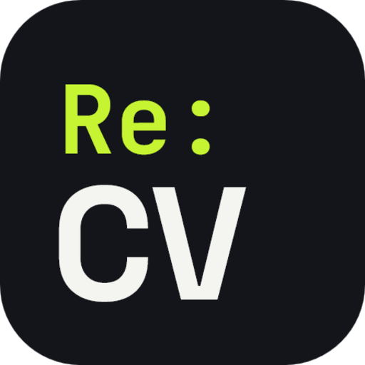
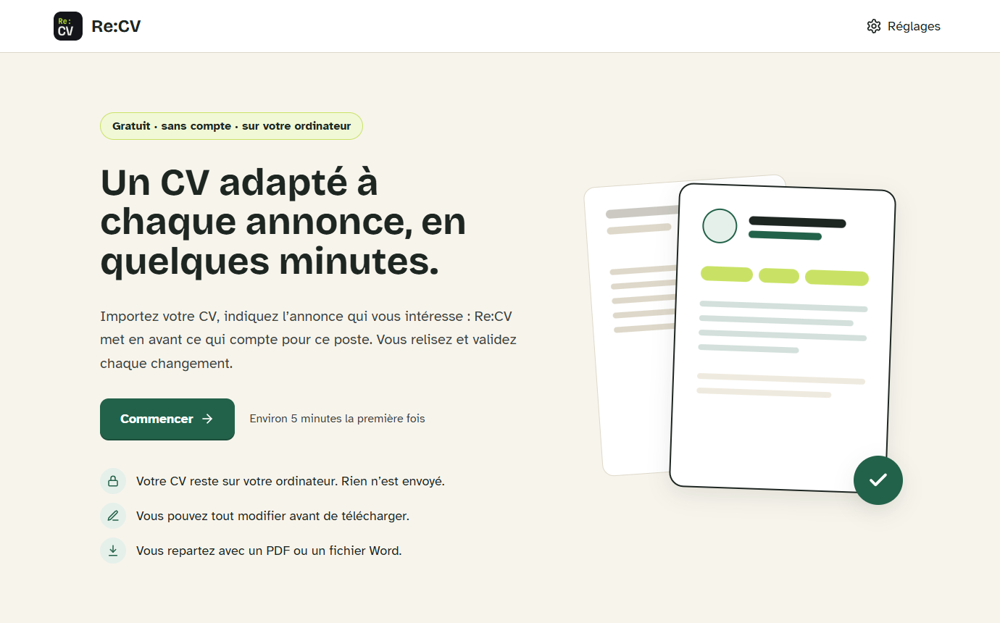
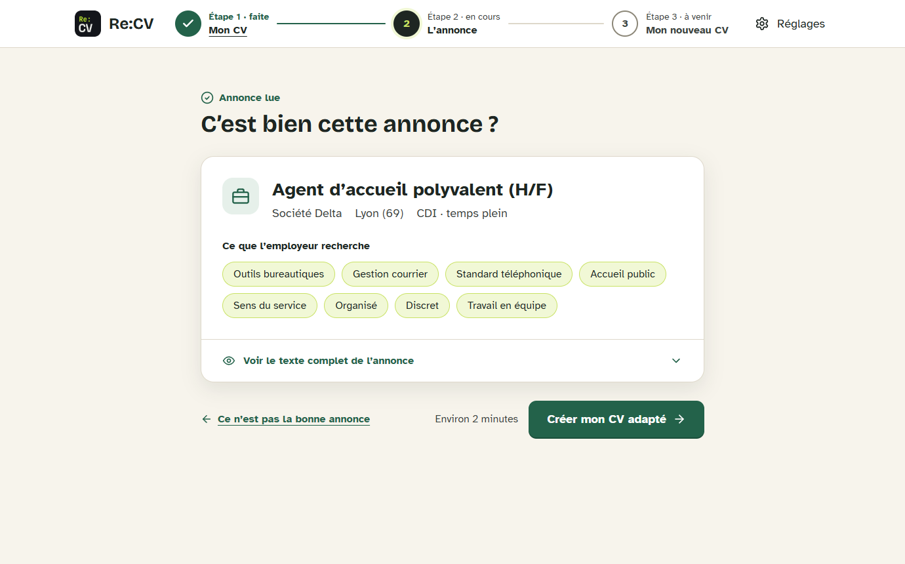
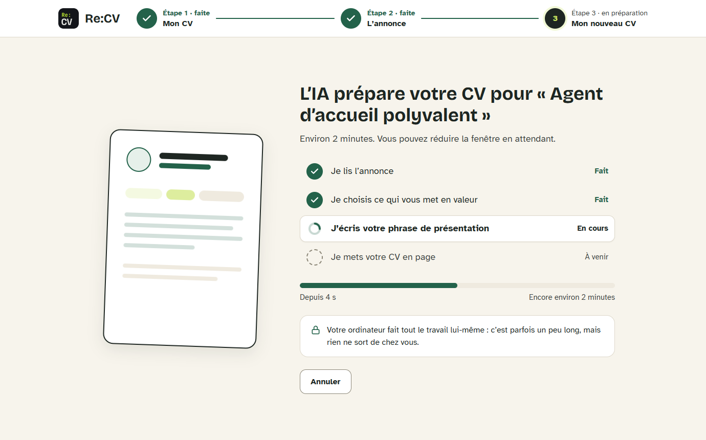

<div align="center">

<h1>
  <br>
  Re:CV
</h1>

**A résumé tailored to each job posting, in minutes.**<br>
Free and open source Windows app. Your résumé stays on your computer.

[](https://github.com/tashom11/ReCV/releases/latest)
[](LICENSE)


[**Download for Windows**](https://github.com/tashom11/ReCV/releases/latest) · 🇫🇷 [Français](README.fr.md)



</div>

---

Re:CV reads your résumé, reads the job posting you are interested in, then brings forward what matters for that job. You review, adjust, and leave with a PDF or a Word file.

> The interface and the produced résumés are in French for now: Re:CV is made for French-speaking job seekers.

## Three steps

| | |
|---|---|
| **① My résumé** | Drop your résumé (PDF or Word). Re:CV shows what it understood; you correct it if needed. |
| **② The posting** | Paste the link to the posting, or its text. Re:CV shows the job and what the employer is looking for. |
| **③ My new résumé** | The tailored résumé is shown full size. You pick a layout, then download. |

<p align="center">
  
  
</p>

## Nothing is invented

Re:CV only selects, reorders and rephrases what is already in your résumé. Job titles, employers, dates, education and languages are copied verbatim.

When the posting asks for a skill your résumé does not mention, it is offered as an **unchecked** box: it only enters the résumé if you check it.

## Where does your data go?

| Engine chosen in Settings | Where does your résumé go? |
|---|---|
| **On my computer** (default) | Nowhere. A model is downloaded once (1.2 to 5.3 GB depending on the level), then everything works offline. |
| **Ollama** | It stays on your computer, or goes to the address you configure. |
| **Online service** (your own key) | It is sent to the chosen service on every run. Some free tiers reuse submitted data: read their terms. |

Your key is encrypted by Windows and never displayed again. There is no account, no advertising and no analytics. A local diagnostic log keeps error codes only (never a message nor CV data); it leaves your computer only if you copy the report from Settings into a bug report.

Besides the chosen engine, Re:CV only goes online to download the model, read a posting from a link and check for updates.

## Install

1. Download `ReCV-Setup-<version>.exe` from the [latest release](https://github.com/tashom11/ReCV/releases/latest).
2. Run it. The installer is not signed yet, so Windows SmartScreen shows a warning. Click “More info”, then “Run anyway”.
3. On first launch, Re:CV downloads the model. Allow a few minutes.

## Updates

Re:CV checks for new versions at startup, then every six hours. An update downloads in the background and installs when the app closes. In Settings, the “Mises à jour” card shows the installed version and lets you check on demand.

## Bugs and ideas

Open an [issue](https://github.com/tashom11/ReCV/issues/new/choose) and paste the diagnostic report into it (Settings → “Signaler un problème”): there is a form to report a problem and another to suggest an idea. English and French are both welcome. For a security vulnerability, follow [SECURITY.md](SECURITY.md) instead.

## Develop

Requirements: Node.js 24 or later, Windows.

```bash
npm install
npm run dev          # app in development mode
npm test             # tests (Vitest, no real model calls)
npm run lint         # Biome
npm run typecheck
npm run build:win    # NSIS installer in release/
npm run try -- fixtures/sample-cv.txt fixtures/sample-job-posting.txt   # full tailoring run without Electron
```

`try` script options: `--provider ollama|api|local`, `--model name`. Variables: `RECV_OLLAMA_URL`, `RECV_API_URL`,
`RECV_API_KEY`, `RECV_GGUF_MODEL`.

| Folder | Role |
|---|---|
| `src/core` | Pure business logic: schemas, résumé and posting parsing, tailoring, export. |
| `src/main` | Main process: database, IPC, models, updates. |
| `src/preload` | Typed bridge between the interface and the main process. |
| `src/renderer` | React interface. Every displayed text lives in `src/renderer/src/i18n/fr.ts`. |

Code, names and comments are in English; the interface texts and the prompts are in French. See [CONTRIBUTING.md](CONTRIBUTING.md) before opening a pull request.

## Release

Add the version's section to [CHANGELOG.md](CHANGELOG.md) first: it becomes the release notes, and the release fails
without it. After a dependency change, also run `node scripts/third-party-notices.mjs` and commit
[THIRD_PARTY_NOTICES.md](THIRD_PARTY_NOTICES.md).

```bash
npm version 0.3.0 --no-git-tag-version
git commit -am "Version 0.3.0"
git tag v0.3.0
git push origin main v0.3.0
```

The GitHub Actions workflow builds the installer, uploads it to a draft release with the changelog section as notes, then publishes it. The tag must match the version in `package.json`.

## License

[MIT](LICENSE)
